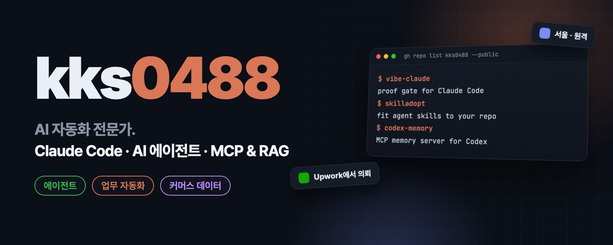

  

  <a href="README.md"><b>English</b></a> · <b>한국어</b>

<h2 align="center">일을 대신하는 AI 도구를 만들고, 그 일이 정말 끝났는지까지 확인합니다.</h2>

  김경수 · 서울 · 한국어·영어로 원격 작업

  
  
  

<table>
<tr>
<td width="50%" valign="top">

### Claude Code·Codex 도구
코딩 AI가 스스로 테스트하고, 백업을 남기고, 맥락을 기억하게 하는 플러그인·스킬·MCP 서버.

</td>
<td width="50%" valign="top">

### 업무 자동화
메일 분류, 정기 수집, 슬랙 알림, 대시보드. 혼자 돌고, 한 일을 보고합니다.

</td>
</tr>
<tr>
<td width="50%" valign="top">

### 커머스 데이터
아디다스 코리아 커머스 데이터 분석가·MD, 타미힐피거·캘빈클라인 한국 아웃렛 데이터 분석가 출신. 매장이 돌아가는 숫자를 압니다.

</td>
<td width="50%" valign="top">

### 확인할 수 있게 만듭니다
실제 테스트, 실제 결과, 사실만 쓴 README. 확인되지 않은 것은 확인되지 않았다고 알려 줍니다.

</td>
</tr>
</table>

## 대표 프로젝트

<table>
<tr>
<td width="50%" valign="top">

**[vibe-claude](https://github.com/kks0488/vibe-claude)** · Python 
코드를 읽지 않는 사람을 위한 Claude Code 플러그인. 실제 테스트가 통과할 때까지 Claude를 돌려보내고, 요청마다 백업하며, "되돌려" 한마디로 파일을 복구합니다.
</td>
<td width="50%" valign="top">

**[skilladopt](https://github.com/kks0488/skilladopt)** · TypeScript · npm 
에이전트 스킬을 그냥 설치하지 말고 입양하세요. 남이 만든 SKILL.md를 내 코드에 맞게 고치고, 근거를 남기고, 프로젝트가 바뀌면 다시 볼 줄을 알려 줍니다.
</td>
</tr>
<tr>
<td width="50%" valign="top">

**[vibe-codex](https://github.com/kks0488/vibe-codex)** · Codex CLI 
Codex CLI용 근거 우선 작업 스킬. 작업 크기에 맞는 계획, 횟수 제한 재시도, 근거 있는 완료 보고, 선택형 로컬 메일박스 런타임.
</td>
<td width="50%" valign="top">

**[codex-memory](https://github.com/kks0488/codex-memory)** · TypeScript · MCP 
OpenAI Codex CLI에 오래 가는 기억을 주는 MCP 서버. 내 컴퓨터의 SQLite에 저장합니다.
</td>
</tr>
<tr>
<td width="50%" valign="top">

**[mystats](https://github.com/kks0488/mystats)** · React · [라이브 데모](https://mystats-eta.vercel.app) 
로컬 우선 AI 일기·커리어 전략 도구. Gemini·OpenAI·Claude·Grok 중 골라 쓰고, 기록은 내 브라우저에 남습니다.
</td>
<td width="50%" valign="top">

**[dailywave](https://github.com/kks0488/dailywave)** · React · [라이브 데모](https://dailywave.vercel.app) 
ADHD 친화 생산성 앱. 한 번에 다음 한 걸음만, 흐름 중심 작업 관리.
</td>
</tr>
<tr>
<td width="50%" valign="top">

**[vibe-inbox](https://github.com/kks0488/vibe-inbox)** · Python · Gmail API 
Gmail 정리 도구. Google Gemini가 메일 내용을 읽고 알맞은 라벨로 분류합니다.
</td>
<td width="50%" valign="top">

**[repofit](https://github.com/kks0488/repofit)** · Python 
내 기술 스택과 목표에 맞는 GitHub 인기 저장소를 찾아 주는 AI 분석 도구.
</td>
</tr>
</table>

더 보기: [hackathon-calendar](https://github.com/kks0488/hackathon-calendar) (구독형 해커톤 캘린더) · [전체 저장소](https://github.com/kks0488?tab=repositories)

## 쓰는 도구

  
  
  
  
  
  
  
  
  
  

## 함께 일하기

AI 에이전트, 업무 자동화, 팀용 Claude Code·Codex 설정이 필요하면
**[Upwork](https://www.upwork.com/freelancers/~0197507708d4b35a03)**로 의뢰해 주세요.
