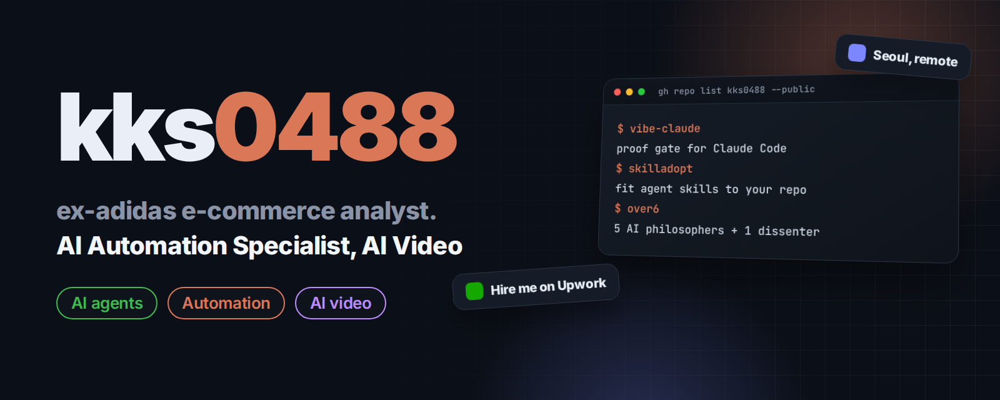

  

  <b>English</b> | <a href="README.ko.md"><b>한국어</b></a>

<h2 align="center">AI Automation Specialist | AI Video | ex-adidas e-commerce analyst</h2>

  I build AI agents and automations that do the work, and check that the work actually got done. Kyoungsoo Kim | Seoul, Korea | working remotely in English and Korean

  
  
  
  

## What I do

<table>
<tr>
<td width="50%" valign="top">

### 🤖 AI agents & coding tools
Claude Code and Codex plugins, skills and MCP servers that make agents test their work, keep backups and remember context.

</td>
<td width="50%" valign="top">

### ⚙️ Business automation
Email triage, scheduled scrapers, Slack alerts, dashboards and store operations that run on their own and report what they did.

</td>
</tr>
<tr>
<td width="50%" valign="top">

### 📊 E-commerce data
Former commerce data analyst and MD at adidas Korea, data analyst for Tommy Hilfiger and Calvin Klein outlets in Korea, then ran my own fashion outlet store.

</td>
<td width="50%" valign="top">

### 🎬 Video & AI video
Freelance video shooting and editing, including architecture and interior films, now combined with AI image and video tools.

</td>
</tr>
</table>

## Featured projects

<table>
<tr>
<td width="50%" valign="top">

**[agent-wallboard](https://github.com/kks0488/agent-wallboard)** | Python | tablet dashboard 
Turn an old tablet into a calm wall display for a team of AI agents and the one person who runs them.
</td>
<td width="50%" valign="top">

**[vibe-claude](https://github.com/kks0488/vibe-claude)** | Python | Claude Code plugin 
Claude is sent back until a real test passes, every request is backed up, and "undo" restores files. For people who build with AI but don't read code.
</td>
</tr>
<tr>
<td width="50%" valign="top">

**[skilladopt](https://github.com/kks0488/skilladopt)** | TypeScript | npm CLI 
Don't install agent skills, adopt them. Fits third-party SKILL.md files to your codebase, keeps the evidence and shows what a change invalidated.
</td>
<td width="50%" valign="top">

**[over6](https://github.com/kks0488/over6)** | Next.js | multi-agent 
Five AI philosophers from 12 traditions debate your question over three rounds; a sixth AI takes the consensus apart. You decide.
</td>
</tr>
<tr>
<td width="50%" valign="top">

**[vibe-codex](https://github.com/kks0488/vibe-codex)** | Codex CLI | skills 
Evidence-first workflow skills for Codex CLI: right-sized plans, bounded retries, completion claims backed by evidence.
</td>
<td width="50%" valign="top">

**[codex-memory](https://github.com/kks0488/codex-memory)** | TypeScript | MCP server 
Gives OpenAI Codex CLI persistent memory through MCP, stored locally in SQLite.
</td>
</tr>
<tr>
<td width="50%" valign="top">

**[mystats](https://github.com/kks0488/mystats)** | React | AI journal | [live demo](https://mystats-eta.vercel.app) 
Local-first AI journal that turns your notes into skills, patterns and a career strategy. Bring your own Gemini, OpenAI, Claude or Grok key.
</td>
<td width="50%" valign="top">

**[dailywave](https://github.com/kks0488/dailywave)** | React + FastAPI | [live demo](https://dailywave.vercel.app) 
ADHD-friendly flow planner: dump the chaos, then see one clear next step.
</td>
</tr>
<tr>
<td width="50%" valign="top">

**[vibe-inbox](https://github.com/kks0488/vibe-inbox)** | Python | Gmail API 
Gmail organizer: an AI model reads each email and files it into the right label, with sender learning and Slack reports.
</td>
<td width="50%" valign="top">

**[repofit](https://github.com/kks0488/repofit)** | Python | Next.js 
AI-assisted GitHub trending analyzer that finds repositories matching your stack and goals.
</td>
</tr>
<tr>
<td width="50%" valign="top">

**[hackathon-calendar](https://github.com/kks0488/hackathon-calendar)** | Shell | iCalendar 
Subscribe to hackathon deadlines in Apple or Google Calendar from one .ics feed.
</td>
</tr>
</table>

<a href="https://github.com/kks0488?tab=repositories">All repositories →</a>

## GitHub stats

  

## Tech stack

  
  
  
  
  
   
  
  
  
  
  
   
  
  
  
  
  
  

## Work with me

  Need an AI agent, an automation, a Claude Code / Codex setup for your team, or AI video? Send me the job on Upwork.

  

